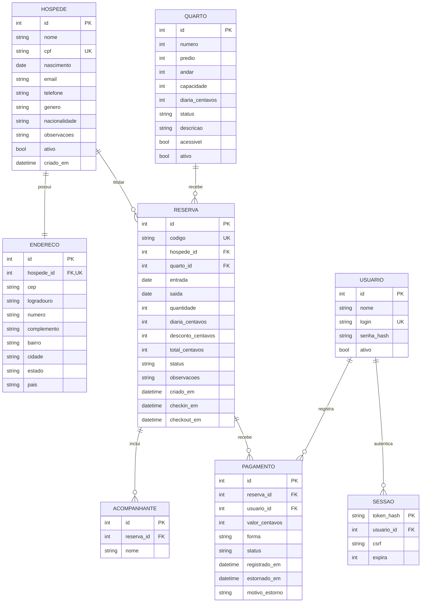
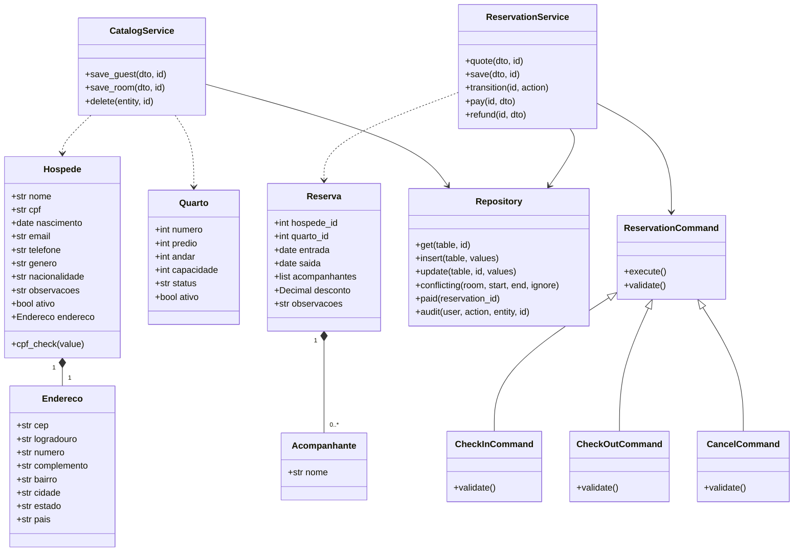
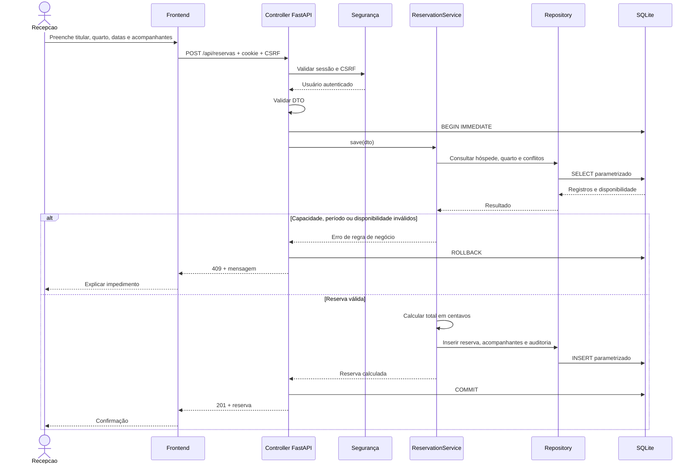
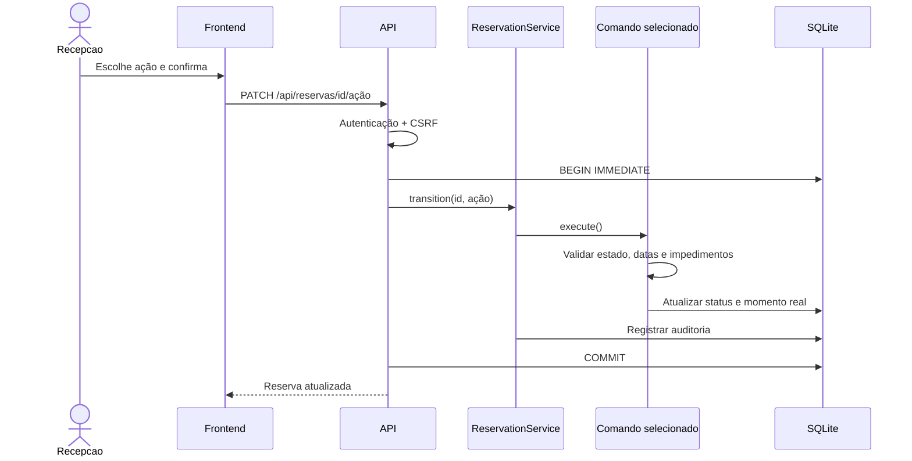
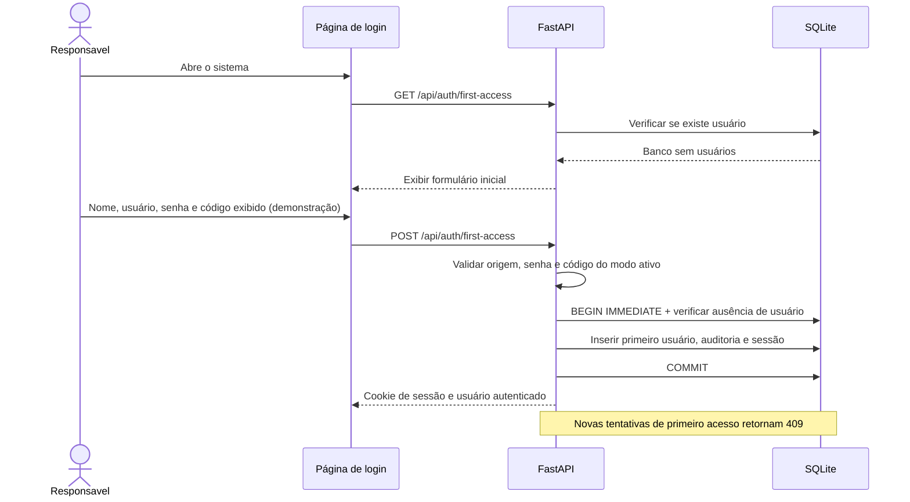

# Diagramas do ColôniaWeb

## Entidades e relacionamentos

Os 11 atributos de Hóspede, 10 de Quarto e 15 de Reserva são persistidos. `quantidade` é calculada a partir do titular e dos acompanhantes. `ENDERECO.hospede_id` é único; a criação de hóspede/endereço é atômica. Registros de endereço representam o endereço individual do cadastro, mesmo quando duas pessoas informam o mesmo logradouro.

Na implantação atual, `layout.py` cadastra automaticamente 14 quartos no prédio 1, com `andar/numero` 1/101–107 e 2/201–207. A diária é R$ 100 no 1º andar e R$ 120 no 2º. Não existe entidade Categoria. A planta é fixa na API; `situacao_atual` não é uma coluna persistida, mas um valor derivado de `ativo`, `status` e reservas `HOSPEDADA`.

## Classes de domínio e implementação

Os DTOs Pydantic representam entradas de domínio; a persistência usa linhas SQLite via DAO, sem entidades ORM ocultas.

## Sequência: confirmar reserva

## Sequência: check-in / check-out / cancelamento

## Sequência: primeiro acesso

